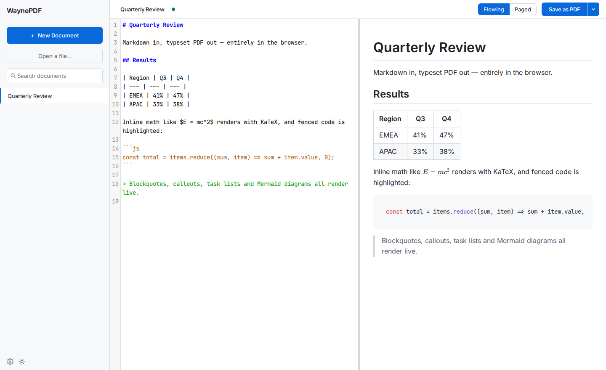
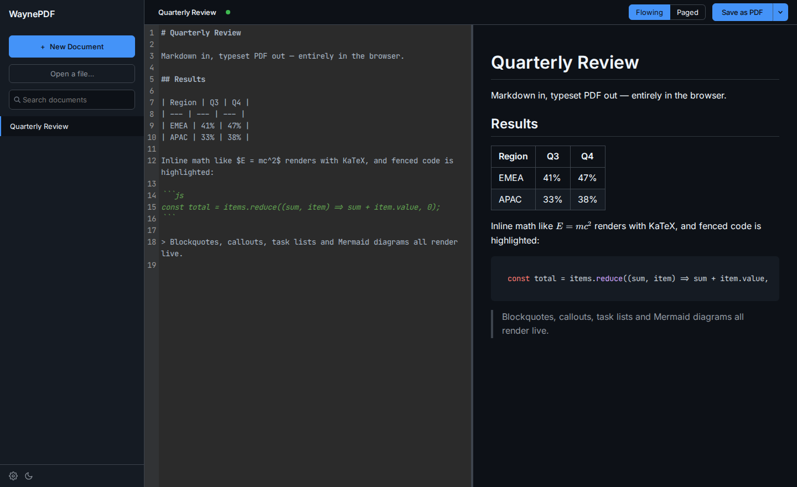
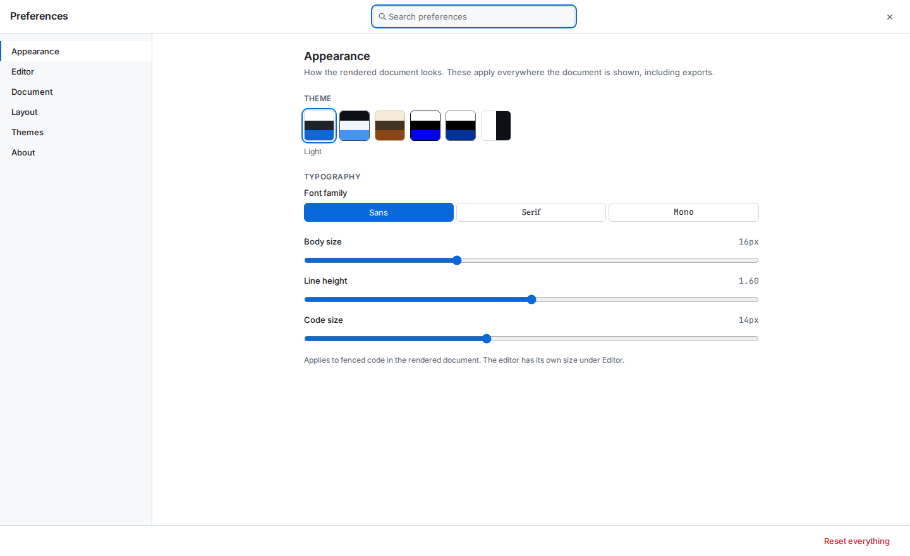

# WaynePDF

Write Markdown. Get a beautiful PDF. Offline, private, and yours to configure.



## What it is

WaynePDF is a browser-based Markdown-to-PDF converter. You paste or drop
Markdown, it renders it with clean styling, and you save it to PDF using your
browser's built-in print dialog. Nothing you write ever leaves your machine —
there's no backend, no telemetry, no analytics, and no accounts.

Under the hood it's a React 18 + Vite SPA with a PWA manifest, so you can
install it and use it fully offline once it's loaded.

## Getting started

### Use it online

[Deployed URL to be added]

### Run it locally

Requires **Node 22** and **pnpm**.

```bash
git clone git@github.com:mrwayne-dev/waynepdf.git
cd waynepdf
nvm use 22
corepack enable pnpm
pnpm install
pnpm dev
```

Open `http://localhost:5173`.

### Run it in Docker

```bash
docker build -t waynepdf .
docker run -p 8080:80 waynepdf
```

Open `http://localhost:8080`.

## Usage

Documents live in the sidebar on the left. Click **+ New Document** to start one,
**Open a file…** to import a `.md`, or drop a file anywhere on the window. Search
filters the list, rows drag to reorder, and right-clicking one offers Rename and
Duplicate.

Type on the left, watch the preview on the right. The top bar carries the
document's title — click it to rename — a dot showing autosave state, the
**Flowing** / **Paged** preview toggle, and the export button.

When you're ready, click **Save as PDF** and pick **Save as PDF** in the print
dialog. For cleaner output, uncheck **Headers and Footers** in that dialog —
backgrounds print automatically.



### Preferences

Press <kbd>Cmd</kbd>+<kbd>,</kbd> (<kbd>Ctrl</kbd>+<kbd>,</kbd> elsewhere) or
click the gear in the sidebar footer. Preferences opens as a full window over
the workspace — nothing is unmounted, so your document, scroll position and
in-flight autosave are exactly where you left them when you close it.

Six sections: **Appearance** (theme, fonts, sizes), **Editor**, **Document**
(language, direction, math, sanitization), **Layout** (page size, margins,
headers, footers, cover, watermark, table of contents), **Themes** (your own
palettes), and **About**. The search box at the top filters both the section
list and the controls inside a section.



### Keyboard shortcuts

| Shortcut | Action |
| --- | --- |
| <kbd>Cmd/Ctrl</kbd>+<kbd>,</kbd> | Toggle preferences |
| <kbd>Cmd/Ctrl</kbd>+<kbd>N</kbd> | New document |
| <kbd>Esc</kbd> | Close preferences, menus, or a rename |
| <kbd>↑</kbd> <kbd>↓</kbd> | Move through the preferences sections |

Shortcuts deliberately yield to text fields, so they do nothing while the
editor has focus.

### Themes and typography

Preferences → Appearance carries five themes — Light, Dark, Sepia, High Contrast
and Print Optimized — plus a System option that follows your OS. The sidebar
footer has a one-click toggle that cycles Light → Dark → System; the full set,
including your own custom palettes, lives in preferences. Body font (Inter,
Source Serif 4 or JetBrains Mono), body size, line height and code size are all
adjustable, and the preview updates live. Settings persist in `localStorage`
under `waynepdf.settings.v1`.

All three fonts are bundled as WOFF2 and served from the app's own origin, so
they work offline and no request ever leaves your machine.

## Export formats

- **PDF** — full fidelity. Themes, fonts, math, diagrams, callouts and page
  layout: everything you see is what prints.
- **HTML** — a single self-contained file. All CSS and fonts are inlined as data
  URIs, so it opens in any browser with identical rendering and makes no network
  requests at all.
- **DOCX** — a reasonable transformation for Word and LibreOffice, written
  in-house rather than by bundling a converter.

  *Preserved:* headings, paragraphs with bold/italic/strikethrough/code/links,
  ordered and unordered lists (three levels of nesting), task lists, tables with
  a repeating header row, blockquotes, code blocks, images, and diagrams as
  embedded PNGs. Frontmatter `title`, `author` and `date` become document
  metadata.

  *Not preserved:* rendered math — the LaTeX source travels as literal text you
  can paste into Word's equation editor; syntax highlighting — code is monospace
  on a plain ground; custom theme colours — DOCX uses Word's own styling;
  callout colours — a callout becomes a blockquote prefixed with `[NOTE]`,
  `[WARNING]` and so on; right-to-left text direction — the whole document is
  laid out left-to-right.

  Reach for HTML or PDF when fidelity matters, and DOCX when the point is to
  hand someone content they can edit.

## Roadmap

WaynePDF was built in phases. Current state: **all phases complete**.

- **Phase 0** — Vite + React 18 foundation, markdown-it parser, test harness.
  Done.
- **Phase 1** — Debranding and identity. Done.
- **Phase 2** — Theming layer: five themes, three bundled fonts, settings panel.
  Done.
- **Phase 3** — Unicode correctness: BOM handling, encoding detection,
  `lang`/`dir` support. Done.
- **Phase 4** — Math rendering via KaTeX. Done.
- **Phase 5** — Real PDF output via paged.js: page control, running
  headers/footers, TOC. Done.
- **Phase 6** — Frontmatter, autosave, Mermaid, callouts, task lists,
  sanitization, custom themes, HTML and DOCX export. Done.
- **Phase 7** — Workspace layout: left sidebar navigation, full-screen
  preferences, thin top bar. Done.

Syntax highlighting via Shiki was evaluated in Phase 6e and declined — see
[Syntax highlighting](#syntax-highlighting) below.

## Development

```bash
pnpm dev              # dev server
pnpm build            # production build
pnpm preview          # preview production build
pnpm test             # unit tests (Vitest)
pnpm test:e2e         # browser tests (Playwright), both projects
pnpm test:e2e:parallel # everything except pagination, multi-worker
pnpm test:e2e:paged   # pagination only, single worker
pnpm lint             # ESLint
pnpm format           # Prettier
pnpm gen:icons        # regenerate favicon and PWA icons from public/favicon.svg
```

### Syntax highlighting

WaynePDF uses highlight.js with a curated 47-language grammar set. Shiki (the
VS Code tokenizer) was evaluated and declined: the bundle cost and
theme-integration complexity outweighed the marginal visual improvement for a
general-purpose Markdown tool.

The specifics, since "marginal" is doing real work in that sentence. Shiki's
dual-theme output bakes one theme's colours into `color:` as literal hex and
carries the other in a custom property, which supports exactly two themes —
WaynePDF has five plus user-defined ones. Its CSS-variables theme integrates
cleanly with the theme layer instead, but emits 11 token variables where
highlight.js already emits 40 token classes, so the compatible mode is a
downgrade in colour granularity. Measured cost for the 47-language set: the
preview chunk grows 199.87 kB → 564.35 kB gzipped, the precache grows 2.93 MB,
and compiling the grammars blocks the main thread for ~983 ms at startup.

If you need VS Code-fidelity highlighting for a specific use case, the syntax
highlighter is a small, well-isolated module — see
`src/App/Components/Previewer/Preview.jsx`.

### Icons

Every icon the app ships — the SVG favicon, the ICO fallback, the PWA icons,
the Apple touch icon, and the social share image — is generated from the single
master at `public/favicon.svg` by `scripts/generate-icons.mjs`. To change the
mark, edit that SVG and run `pnpm gen:icons`; the generated files are committed,
and the script is idempotent, so a re-run with an unchanged master produces
byte-identical output.

## Credits

WaynePDF is a fork and rewrite of
[realdennis/md2pdf](https://github.com/realdennis/md2pdf), an offline-first
Markdown-to-PDF web app. The original project is MIT-licensed; upstream's
license is preserved in `UPSTREAM_LICENSE`. Every substantive component has been
rewritten, but the debt is real and acknowledged.

## License

MIT. See `LICENSE` for the current copyright and `UPSTREAM_LICENSE` for the
original.
